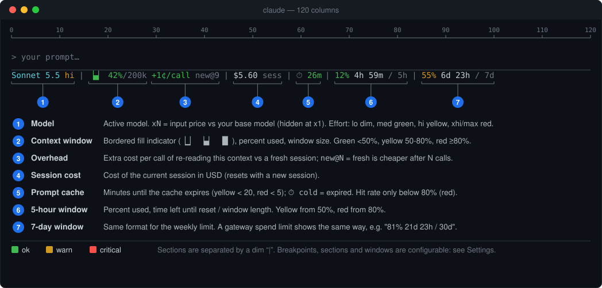

# claude-code-status-line

A [Claude Code](https://claude.com/claude-code) status line, packaged as a plugin. One line with the model, its price multiplier and effort level, context usage, session tokens and cost, prompt-cache time left and hit rate, and rate-limit resets. About 90 columns with the default windows; it shrinks itself on narrow terminals.

[What you see](#what-you-see) · [Install](#install) · [Settings](#settings) · [Narrow terminals](#narrow-terminals) · [Troubleshooting](#troubleshooting)

## What you see



The same in plain text:

```text
         10        20        30        40        50        60        70        80        90       100       110       120
123456789012345678901234567890123456789012345678901234567890123456789012345678901234567890123456789012345678901234567890
Sonnet 5.5 hi | ▕▄▏ 42%/200k | $5.60 sess | ⏱ 25m | 12% 4h 59m / 5h | 55% 6d 23h / 7d
└─────────1──────────┘   └─────2──────┘   └─────3─────┘   └───────4───────┘   └──────5──────┘   └──────6──────┘
```

| # | Section | Shows | Colors |
|---|---|---|---|
| 1 | **Model** | Active model. `x5` is its input price relative to your base model (hidden when it is x1) (default Sonnet 5.5; change it with `/statusline-model`). Fast mode is priced in. The effort level (`lo`, `med`, `hi`, `xhi`, `max`) follows when Claude Code sends it. | model cyan<br>effort: dim lo · 🟩 med · 🟨 hi · 🟥 xhi/max |
| 2 | **Context** | 3-char bordered indicator (`▕▁▏`–`▕█▏`), percent used, window size. | 🟩 < 50% · 🟨 ≥ 50% · 🟥 ≥ 80% |
| 3 | **Session cost** | Cost in USD of the current session (resets with a new session), as Claude Code reports it. Optional `tokens` section (off by default: it mirrors the context %). | plain, dim `sess` |
| 4 | **Overhead** | Shown in the context segment (no separator). `+4¢/call new@3`: extra cost per call of re-reading this session's context versus a fresh session (cache read 0.1x, write 1.25x/2x by TTL), and (`new@3`) after how many calls a fresh session has cost less in total. Expired cache: `cold +88¢`, the extra one-time re-write. From 80% context it adds `compact 38¢`, the estimated cost of summarizing. Assumes a fresh session of 25k tokens and an 8k summary (`config.sh overhead FRESH SUMMARY`); counts context cost only. | 🟩 < 5¢ · 🟨 < 20¢ · 🟥 ≥ 20¢ per call (`config.sh thresholds overhead`), cold: 🟥 |
| 4b | **Prompt cache** | `⏱ 25m`: whole minutes until the prompt cache expires, `⏱ cold` when it has. The hit rate is appended only when below 80% (`⏱ 25m 62%`), or always with the `stats` section. | time: 🟩 · 🟨 < 20 min · 🟥 < 5 min<br>hit rate: 🟥 < 80% |
| 5 | **5-hour window** | `<used %> <time to reset> / <window length>` | 🟩 < 50% · 🟨 ≥ 50% · 🟥 ≥ 80% |
| 6 | **7-day window** | Same format. A gateway spend limit looks the same, e.g. `81% 21d 23h / 30d`. | as above |
| 7 | **Extra windows** | Optional (`/statusline-resets all`): any other window the API sends (for example a per-model weekly limit), shown with a dim name. | as above |

- Durations show their two most significant units (`6d 23h`, `24m 58s`, `59s`).
- Sections are separated by a dim `|`, and a section with no data disappears.
- A **custom reset** is a countdown you define yourself (`STATUSLINE_CUSTOM_RESET`, see [Environment overrides](#environment-overrides)).
- Everything above is configurable: [Settings](#settings).

## Install

```
/plugin marketplace add sergemso/claude-code-status-line
/plugin install statusline@claude-code-status-line
/statusline:setup
```

`/statusline:setup [--interval SECONDS] [--force]` points `statusLine` in `~/.claude/settings.json` at `~/.claude/statusline/statusline.sh` (refresh every 15 s unless `--interval` says otherwise; refuses to replace an existing different one unless you pass `--force`). A SessionStart hook keeps that copy in sync with the installed plugin version, so updates need no re-run.

Requires `bash`, `jq`, `curl` and `awk` (Linux and macOS; Windows is not supported). The `/statusline-*` commands need a Claude Code version that supports plugin modules; the rest works without them.

**Update:** `/plugin marketplace update claude-code-status-line`, then `/reload-plugins`. The script copy in `~/.claude/statusline/` is refreshed at the next session start.

**Uninstall:** remove the plugin in `/plugin`, delete the `statusLine` entry from `~/.claude/settings.json`, and delete `~/.claude/statusline/`.

## Settings

Three ways to change them, all writing `~/.claude/statusline/config` (read on every refresh):

| | Command | Model turn? |
|---|---|---|
| Typed commands | `/statusline-show`, `-model`, `-sections`, `-resets`, `-thresholds`, `-width`, `-reset` | none: answered by the plugin itself |
| Guided picker | `/statusline:config` | yes (questions go through the model) |
| Shell | `! bash ~/.claude/statusline/config.sh <command>` | none |

Examples:

```
/statusline-show
/statusline-model Claude Opus 5.5        # or: /statusline-model list
/statusline-sections hide stats          # show | hide | only NAME... | all
/statusline-resets 5h,7d,spend           # or: all | none
/statusline-thresholds context 60 85     # yellow/red at % used; also: resets, cache (minutes left: 30 10)
/statusline-width 100                    # or: auto
/statusline-reset                        # drop saved settings (or: /statusline-reset BASE_MODEL)
```

| Setting | Meaning |
|---|---|
| model | Base model for the price multiplier, validated against the price table (names match case-insensitively, with or without `Claude `) |
| sections | Enable or disable `model context tokens cost overhead cache stats resets` (`stats` = always show the cache hit rate; default only when below 80%) |
| resets | Which reset windows to show. Items are API keys (`seven_day_opus`) or aliases (`5h`, `7d`, `spend`, `7d-opus`); `all` shows every window the API sends. Windows other than 5h/7d/spend carry a dim name, e.g. `opus 83% 6d 23h / 7d` |
| thresholds | `context`/`resets`: yellow/red at WARN/CRIT percent used (defaults 50/80). `cache`: yellow/red when WARN/CRIT minutes are left (20/5) |
| width, margin | Columns to fit the line into (see [Narrow terminals](#narrow-terminals)); columns kept free at the right edge (default 2) |
| dump | `config.sh dump PATH` writes the raw status-line JSON and width diagnostics there each run; `dump off` stops it |

The refresh interval itself is `refreshInterval` in `settings.json`: `/statusline:setup --interval SECONDS`. Module commands can't contain a colon, which is why the typed commands are `/statusline-…` while the markdown ones are `/statusline:…`.

### Environment overrides

An env var `STATUSLINE_<KEY>` (e.g. `STATUSLINE_RESETS`, `STATUSLINE_CONTEXT_WARN`, `STATUSLINE_SECTIONS`) wins over the saved value; set it in the `env` block of `~/.claude/settings.json`. Also:

| Variable | Meaning |
|---|---|
| `STATUSLINE_PRICES_TTL` | Seconds before the price table is re-fetched (default 3600; also settable as `PRICES_TTL` in the config file) |
| `STATUSLINE_CUSTOM_RESET` | `label\|YYYY-MM-DD HH:MM` adds a countdown section, e.g. `sprint\|2026-10-17 09:00` (part of the `resets` section) |
| `STATUSLINE_DUMP` | Same as `config.sh dump PATH`: the raw status-line JSON (to see which windows your account gets) plus width/level diagnostics |
| `CLAUDE_CONFIG_DIR` | Config directory (default `~/.claude`) |

Model price multipliers come from the public pricing page, cached in `~/.claude/model-prices.json`.

## Narrow terminals

On every refresh the script reads the terminal width (`stty size </dev/tty`) and, if the line is too wide, drops one thing at a time until it fits. There is no resize notification, so the line adapts at the next refresh: after `refreshInterval` seconds, or sooner when Claude Code re-runs it for an event. A smaller interval (`/statusline:setup --interval 5`) reacts faster.

| Level | Dropped, cumulatively | Example (default windows) |
|---|---|---|
| 0 | nothing | `Sonnet 5.5 hi \| ▕▄▏ 42%/200k \| $5.60 sess \| ⏱ 25m \| 12% 4h 59m / 5h \| 55% 6d 23h / 7d` |
| 1 | context window size, named extra windows, custom reset | `… \| ▕▄▏ 42% \| $5.60 sess \| …` |
| 2 | cache hit rate, overhead detail | `… \| ⏱ 25m \| 12% 4h 59m / 5h \| …` |
| 3 | `/ total` on windows, session cost | `… \| ⏱ 25m \| 12% 4h 59m \| 55% 6d 22h` |
| 4 | price multiplier, effort level, windows after the first | `Sonnet 5.5 \| ▕▄▏ 42% \| ⏱ 25m \| 12% 4h 59m` |
| 5 | cache, tokens (if enabled), overhead | `Sonnet 5.5 \| ▕▄▏ 42% \| 12% 4h 59m` |
| 6 | reset windows | `Sonnet 5.5 \| ▕▄▏ 42%` |

If the width can't be read (no tty), nothing is dropped; set it by hand with `config.sh width 100`. If `/dev/tty` isn't available to the script it uses the tty of the nearest parent process that has one. To see what it detected, run `config.sh dump /tmp/sl.txt` (or set `STATUSLINE_DUMP`): each run writes the raw JSON there, then a line `cols=… margin=… level=… visible=…`; `config.sh dump off` stops it.

## Troubleshooting

| Symptom | Cause and fix |
|---|---|
| The old status line is still there | `/statusline:setup --force` replaces an existing `statusLine` setting. Check that `jq` is installed. |
| Reset windows (`12% 3h / 5h`) are missing | They exist on subscription accounts only (enterprise and API-key sessions get no `rate_limits` from Claude Code, so nothing is shown; the tokens and cost sections still work), and only when listed in `resets`. A saved list such as `spend` hides the rest: run `/statusline-reset RESETS`. To see which windows your account gets: `! bash ~/.claude/statusline/config.sh dump /tmp/sl.txt`, then read the file. |
| The multiplier says `(x2.0)` | It is relative to your base model, which defaults to Sonnet 5.5. Set it with `/statusline-model`. |
| `no cache` | The prompt cache has expired or has not been written yet; it turns into a countdown after the next request. |
| The line never gets shorter in a small window | The width could not be read. Set it by hand with `/statusline-width 100`, or use `dump` (see [Narrow terminals](#narrow-terminals)). |
| `/statusline-*` commands are not found | Run `/reload-plugins`. They need a Claude Code version with plugin modules; `! bash ~/.claude/statusline/config.sh <command>` always works. |
| A setting seems ignored | An env var `STATUSLINE_<KEY>` beats the saved value. `/statusline-show` lists each value and where it comes from. |
