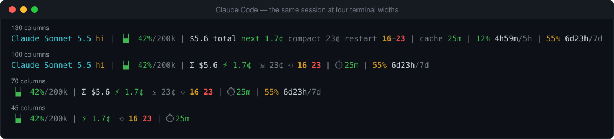
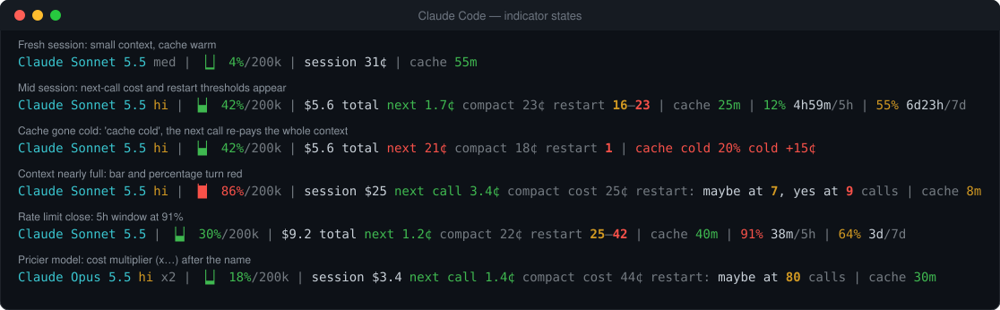

# Claude Code

The status line runs as an external command: Claude Code pipes a JSON payload to its stdin on every refresh and shows what it prints. All sections are available here (model, context, cost, restart economics, prompt cache, rate limits).



*One session at four terminal widths: readable words, then shorter forms, then glyphs, then items are dropped lowest-priority first. These images are real output of the built binary (`npm run docs:images`), not screenshots of Claude Code.*

## Install

Pick one. Requirements: Node.js ≥ 18; the marketplace and script routes also need `git`.

| Route | Commands | Updates |
|---|---|---|
| **Plugin marketplace** (recommended) | `/plugin marketplace add sergemso/claude-code-status-line`<br>`/plugin install statusline@claude-code-status-line`<br>`/statusline:setup` | The SessionStart hook rebuilds the binary when the plugin updates |
| **npm** | `npx @statusline/claude-plugin install --configure` | Run it again (`@latest`, or `@<version>` to pin) |
| **One-shot script** | `curl -fsSL https://raw.githubusercontent.com/sergemso/claude-code-status-line/main/scripts/install-claude-code.sh \| bash` | `git pull && npm install` in `~/.claude/claude-code-status-line` |
| **From a clone** | `npm install && ./bin/statusline install --configure` | Pull and rebuild |

Restart Claude Code afterwards.

### What setup changes

`install --configure` (which `/statusline:setup` runs) does two things:

1. Copies a self-contained binary to `~/.claude/statusline/statusline`.
2. **Merges** a `statusLine` entry into `~/.claude/settings.json`, keeping everything else:

```json
{
  "statusLine": {
    "type": "command",
    "command": "/home/you/.claude/statusline/statusline",
    "refreshInterval": 15
  }
}
```

It refuses to replace a different `statusLine` unless you pass `--force`; `--interval N` sets the refresh seconds. Use an absolute path if you edit the file yourself.

> **The plugin is not what draws the line.** Claude Code plugins cannot declare a `statusLine`, so setup writes it into your own `settings.json`. Disabling or uninstalling the plugin therefore does **not** stop the status line, and the plugin's update hook stops running. See [Uninstalling](#uninstalling).

## Check it works

```bash
echo '{"session_id":"test","model":{"id":"claude-sonnet-5-5","display_name":"Sonnet 5.5"},"cost":{"total_cost_usd":0.5},"context_window":{"context_window_size":200000,"used_percentage":12}}' \
  | ~/.claude/statusline/statusline
```

`session_id`, `model` (with `id` and `display_name`), `cost` and `context_window` are required; anything else is optional and its indicator is simply hidden when absent. `statusline config show` lists your settings and where each comes from.

## What you see



| You see | It means |
|---|---|
| `Claude Sonnet 5.5 hi` | Model and effort level. `x2` after the name is the cost multiplier against your base model. |
| `▕▄▏ 42%/200k` | Context used / window. Green below 50%, yellow from 50%, red from 80%. |
| `session $5.6` (`Σ $5.6`) | Session cost so far. |
| `next 1.7¢` (`⚡`) | Floor cost of the next request: re-reading the context. Jumps when the cache goes cold. |
| `compact 23¢` (`⇲`) | What restarting from a summary (`/compact`) costs. |
| `restart 16–23` (`⟲ 16 23`) | Yellow: restarting is within 30% of staying. Red: restarting is cheaper. In expected calls. Hidden if it would not pay back within 99. |
| `cache 25m` (`⏱`) / `cache cold` | Time until the prompt cache expires, or that it already has. |
| `12% 4h59m/5h` | Rate-limit window: share used, time to reset, window. Subscription accounts only. |

Every indicator and the exact maths are in the [README](../README.md#reading-the-line).

## Configure

- `/statusline:config` in Claude Code, or `~/.claude/statusline/statusline config wizard` in a terminal (measures your real starting context, previews styles at several widths).
- One-off changes: `statusline config format glyph`, `config sections only model context cost`, `config separator ·`, `config resets 5h,7d`, `config width 100`. See the [README](../README.md#configuration) for the full list and the `STATUSLINE_*` environment variables.
- Settings live in `~/.claude/statusline/config`; updates never touch it.

## Updating

Marketplace: `/plugin marketplace update claude-code-status-line`, then `/reload-plugins`. npm: `npx @statusline/claude-plugin@latest install --configure`. Script or clone: `git pull && npm install`.

## Uninstalling

```text
/statusline:uninstall                # or: ~/.claude/statusline/statusline uninstall
/plugin uninstall statusline@claude-code-status-line
/plugin marketplace remove claude-code-status-line
```

`uninstall` removes the `statusLine` entry (only if it still points at our binary) and the copied binary, and keeps your settings; add `--purge` to delete those too. Do this *before* disabling the plugin if you also want the line gone.

## Troubleshooting

| Symptom | Fix |
|---|---|
| Nothing appears | Restart Claude Code; check `statusLine.command` exists and is executable; run the check above by hand to see the error. Claude Code shows no status line until you have accepted the workspace trust dialog, as for hooks ([status line docs](https://code.claude.com/docs/en/statusline.md)). |
| `statusLine already set to: …` | Another status line is configured. Re-run with `--force`. |
| `Invalid Claude Code input format` | The payload is missing a required field (see above). |
| Still showing after disabling the plugin | Expected: see the note under [What setup changes](#what-setup-changes). |
| Reset windows missing | They exist on subscription accounts only. `statusline config dump /tmp/sl.txt` shows what your account sends. |
| Line never shrinks | Terminal width could not be read; `statusline config width 100`. |

More in the [README troubleshooting table](../README.md#troubleshooting).
