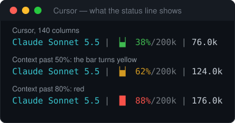

# Cursor

Cursor uses the same external-command contract as Claude Code: it pipes a JSON payload to the command's stdin and shows what it prints. The binary detects Cursor by its payload (it carries `render_width_chars`, `autorun` and `model.param_summary`) and adapts.



*Real output of the built binary for Cursor payloads, not a screenshot of Cursor.*

## What you see

Cursor's payload carries the model, the context window and token totals, but not session cost, prompt-cache timing or rate limits. So the line is shorter than in Claude Code:

| You see | It means |
|---|---|
| `Claude Sonnet 5.5` | Model. |
| `▕▄▏ 38%/200k` | Context used / window. Green below 50%, yellow from 50%, red from 80%. |
| `76.0k` | Tokens in the session. |

`autorun`, `max_mode` and `param_summary` are read into the internal model but are **not drawn** today. Width comes from `render_width_chars`, so no terminal detection is needed.

## Install

```bash
curl -fsSL https://raw.githubusercontent.com/sergemso/ai-tools.agent-status-line/main/scripts/install-cursor.sh | bash
```

This clones the repo to `~/.claude/claude-code-status-line`, builds it, copies the binary to `~/.claude/statusline/statusline` and prints a JSON snippet. Add it to Cursor's configuration, then restart Cursor:

```json
{
  "statusLine": {
    "type": "command",
    "command": "/home/you/.claude/statusline/statusline"
  }
}
```

Use an absolute path. There is no marketplace route: Cursor has no public plugin registry for status lines.

> **Unverified — where the entry goes.** This repo points at two places and I have not checked either against a running Cursor: the install script says Cursor's `settings.json` (`~/.config/Cursor/User/settings.json` on Linux, `~/Library/Application Support/Cursor/User/settings.json` on macOS, `%APPDATA%\Cursor\User\settings.json` on Windows), while [`agent-input-formats.md`](agent-input-formats.md) documents `~/.cursor/cli-config.json` (with `padding`, `updateIntervalMs`, `timeoutMs`), which is presumably the Cursor CLI's file. If the line does not appear, try the other one and please report which worked.

Manual route: `git clone`, `npm install`, then copy `bin/statusline` to `~/.claude/statusline/` and add the entry above.

## Check it works

```bash
echo '{"session_id":"t","render_width_chars":100,"autorun":false,"model":{"id":"claude-sonnet-5-5","display_name":"Claude Sonnet 5.5","param_summary":"","max_mode":false},"workspace":{"current_dir":"/tmp","project_dir":"/tmp","added_dirs":[]},"context_window":{"total_input_tokens":76000,"total_output_tokens":0,"context_window_size":200000,"used_percentage":38,"remaining_percentage":62,"current_usage":{"input_tokens":76000,"output_tokens":0}}}' \
  | ~/.claude/statusline/statusline
```

`statusline agent detect file.json` tells you which adapter claims a payload.

## Configure, update, remove

Settings are shared with Claude Code (`~/.claude/statusline/config`), so `statusline config format glyph`, `config separator ·` and the wizard work the same way; sections that need data Cursor does not send are simply absent. Update by re-running the install script. Remove the `statusLine` entry from Cursor's configuration and delete `~/.claude/statusline/`.

## Troubleshooting

| Symptom | Fix |
|---|---|
| Nothing appears | Restart Cursor; check the command path exists and is executable; see the *Unverified* note above about which file Cursor reads. |
| Wrong agent detected | `statusline agent detect payload.json`; Cursor payloads are matched before Claude Code's, on the Cursor-only fields. |
| No cost or cache timer | Cursor does not send them. |

Adding another agent that works this way: [`adding-adapters.md`](adding-adapters.md).
