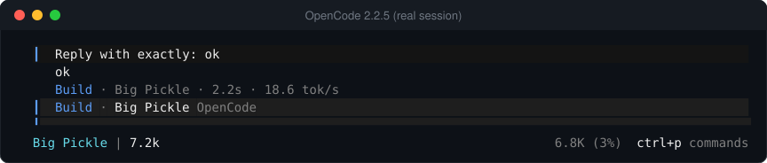
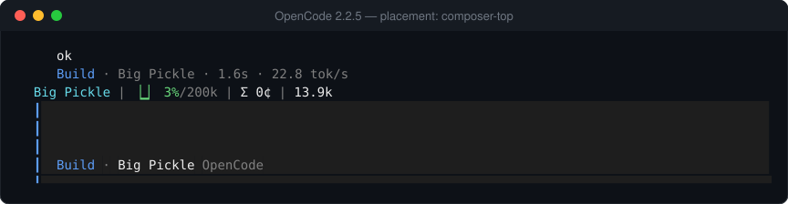

# OpenCode

OpenCode (v2, TUI mode) has no external status-line command. Instead it loads in-process TUI plugins that claim a *slot* in its layout. `@statusline/opencode-plugin` claims a slot, reads the session, model and quota through OpenCode's plugin API, and renders the same line the other agents get.


*Real output of the plugin's renderer. The grey text after the first two lines is OpenCode's own footer, drawn illustratively; this is not a screenshot of OpenCode.*



*Captured from OpenCode 2.2.5 (`--standalone`, tmux pane, free Big Pickle model, after one message), then rendered to SVG with `scripts/render-live-capture.mjs`. `Big Pickle | 7.2k` is the plugin; `6.8K (3%)` and `ctrl+p commands` are OpenCode's own footer.*

**TUI mode only.** In ACP mode (`opencode acp`) the editor draws its own UI and there is no footer to claim.

## Install

```bash
opencode plugin add @statusline/opencode-plugin
```

That adds the package to `~/.config/opencode/opencode.json`:

```json
{
  "$schema": "https://opencode.ai/config.json",
  "plugins": ["@statusline/opencode-plugin"]
}
```

Run `opencode`; the line appears in the footer. Pin a version with `@statusline/opencode-plugin@1.1.2`. `scripts/install-opencode.sh` does the same.

## Placement and sections

OpenCode already shows context use, cost and `ctrl+p commands` on the right of its footer, so by default the plugin renders only `model,tokens,resets` there and leaves a two-column gap. Options go in the plugin entry, in **`~/.config/opencode/cli.json`** (the TUI's own config; the plugin's TUI half reads its options from there, not from `opencode.json`):

```jsonc
{
  "$schema": "https://opencode.ai/v2/cli.json",
  "plugins": [
    {
      "package": "@statusline/opencode-plugin",
      "options": { "placement": "composer-top", "sections": "model,context,cost,tokens,resets" }
    }
  ]
}
```

| `placement` | Where | Default sections |
|---|---|---|
| `replace` (default) | Takes over the footer status slot | `model,tokens,resets` |
| `append` | Adds to the footer status slot | `model,tokens,resets` |
| `composer-top` | Its own full-width row above the prompt | `model,context,cost,tokens,resets` |

> **Checked on OpenCode 2.2.5.** Options written in `opencode.json` never reach the plugin (it receives `{}` and falls back to the footer defaults), and the tuple form `["@statusline/opencode-plugin", {…}]` in `plugins` did not load it at all; in `cli.json` the options arrive. `placement: "composer-top"` drew nothing in 1.1.2 because the line's box used `flex-grow` with a zero basis, which in the column-shaped composer slot collapses its height to zero; releases after 1.1.2 fix that (`replace` and `composer-top` verified, `append` untested).



`sections` overrides the defaults in any placement. Names: `model`, `context`, `cost`, `tokens`, `overhead`, `cache`, `stats`, `resets`, `vim`, `worktree`. The git branch (`worktree`) is never on by default. An unrecognised `placement` falls back to `replace`.

## What you see

| Section | Source |
|---|---|
| `model` | The session's model, by display name from OpenCode's registry |
| `context` | Tokens of the latest request against the model's context limit |
| `cost` | The session's cumulative cost |
| `tokens` | Session tokens |
| `resets` | Provider quota windows (see below) |

`cache` timers, restart economics (`⚡ ⇲ ⟲`) and `vim` need data OpenCode does not expose and are not shown.

### Quota windows

OpenCode has no rate-limit payload, so for **`zai`** and **`zai-cn`** the plugin reads the API key OpenCode saved and fetches the provider's usage endpoint, refreshing every 5 minutes and keeping the last good value through failures. Other providers show no reset windows.

## Update and remove

Update: run `opencode plugin add @statusline/opencode-plugin` again, or pin a version in `opencode.json`. Remove: delete `@statusline/opencode-plugin` from `~/.config/opencode/opencode.json`.

## Troubleshooting

| Symptom | Fix |
|---|---|
| No line | Use TUI mode (`opencode`), not `opencode acp`; check the plugin is in `opencode.json`. |
| Line touches or repeats OpenCode's own footer | Use 1.1.2 or newer, or set `"placement": "composer-top"`. |
| `context.data.listen is undefined` | The TUI entry was loaded as the server part; keep the package's `./tui` export intact. |
| No reset windows | Only `zai` / `zai-cn` are supported. |

Package internals, development and the architecture diagram: [`packages/opencode-plugin/README.md`](../packages/opencode-plugin/README.md).
